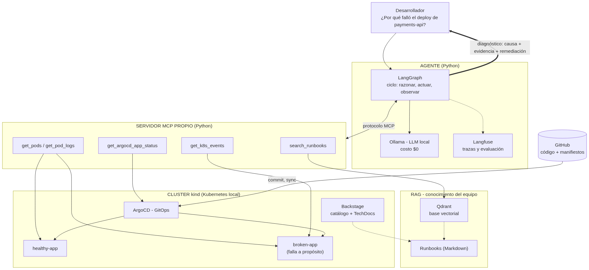
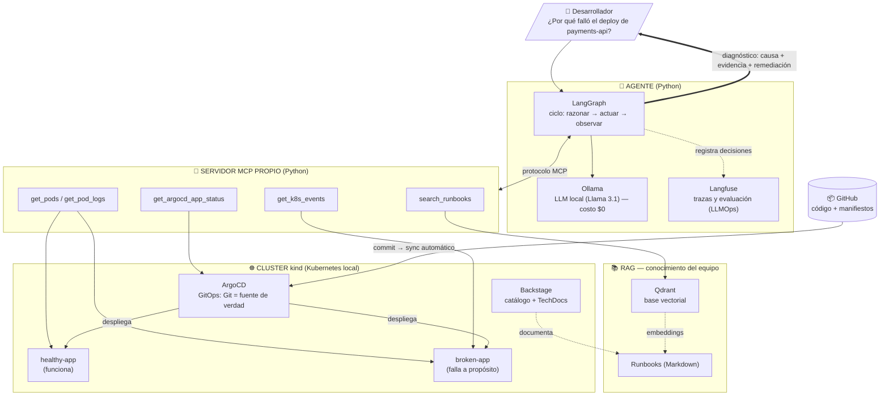

# Arquitectura del DevOps Copilot

Versión en imagen: [arquitectura.png](arquitectura.png) (generada a partir
del diagrama Mermaid de abajo).

El código fuente del diagrama se ve renderizado en GitHub o en cualquier visor
compatible con Mermaid (VS Code con la extensión "Markdown Preview Mermaid
Support", o https://mermaid.live).

## Explicación sencilla: la analogía del médico

Piénsalo como un **médico que diagnostica a un paciente**:

- **👤 Desarrollador** — el que tiene el problema. Hace una pregunta en
  lenguaje natural: "¿por qué falló el deploy?". No necesita saber Kubernetes.
- **🤖 Agente** — el "médico". Es el cerebro del sistema:
  - **LangGraph**: coordina el razonamiento — decide qué revisar primero,
    qué después, y cuándo ya tiene suficiente información para concluir.
  - **Ollama**: el LLM local que piensa y redacta la respuesta. Gratis,
    corre en tu PC.
  - **Langfuse**: la "libreta del médico" — anota todo lo que el agente
    hizo para luego evaluar si diagnosticó bien.
- **🔌 Servidor MCP** — los "instrumentos médicos" (estetoscopio, termómetro).
  Son las herramientas que el agente usa para examinar al paciente: ver el
  estado del deploy en ArgoCD, leer logs de los pods, ver eventos del cluster
  y buscar en los runbooks. El agente no toca el cluster directamente;
  siempre pasa por estas herramientas.
- **☸️ Cluster kind** — el "paciente". Un Kubernetes local donde viven:
  - **healthy-app**: la app sana (paciente sin síntomas).
  - **broken-app**: la app enferma a propósito (los casos a diagnosticar).
  - **ArgoCD**: el "historial clínico" — sabe qué versión se desplegó,
    cuándo, y si está sana o degradada.
  - **Backstage**: el portal donde está documentado todo (catálogo de
    servicios).
- **📚 RAG** — la "enciclopedia médica del equipo":
  - **Runbooks**: documentos escritos por humanos con soluciones a
    problemas conocidos.
  - **Qdrant**: el buscador que encuentra el runbook correcto aunque no
    uses las palabras exactas.
- **📦 GitHub** — el "archivo central". Todo el código y los manifiestos
  viven ahí; ArgoCD los sincroniza al cluster automáticamente.

**El flujo en una frase:** preguntas → el agente piensa qué revisar → usa
las herramientas MCP para examinar el cluster y consultar la enciclopedia →
te devuelve el diagnóstico con la causa, la evidencia y la cura.

## Cómo leer el diagrama

- **Flujo principal** (de arriba hacia abajo): el desarrollador pregunta →
  el agente razona con el LLM local → decide qué herramientas MCP llamar →
  las herramientas consultan el cluster real (ArgoCD, pods, eventos) y los
  runbooks (RAG) → el agente sintetiza el diagnóstico y responde.
- **GitOps** (lado derecho): los manifiestos viven en GitHub; ArgoCD los
  sincroniza al cluster. Romper la app es hacer un commit — y eso genera el
  incidente que el agente diagnostica.
- **Cada caja es una fase del roadmap**: K8S = Fase 1, MCP = Fase 2,
  AGENT = Fase 3, RAG = Fase 4, Langfuse = Fase 5.
